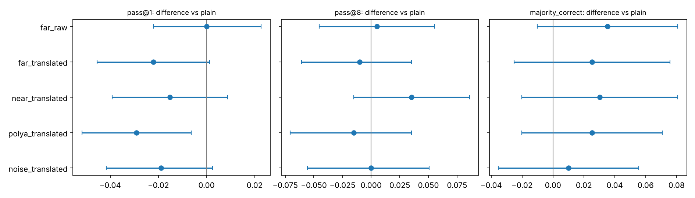

# Seeded reasoning: do ideas from distant fields help a small LLM solve math?

**Question.** People often solve a problem with an idea borrowed from a far-away field.
If a small LLM (Qwen2.5-1.5B-Instruct) gets a one-sentence strategy derived from an idea
in Daoism, cooking or martial arts, does it solve more math problems than with a math
heuristic, a physics principle, or random words? And does the *distance* of the source
field matter, once the extra step and extra tokens are controlled for?

> Status: Phase 1 is done. Result: a clean null. A one-sentence strategy at the start does not
> help, whatever field it comes from. Predictions were written before the run (see git history);
> results and verdicts are below. Phase 2 (confidence-triggered injection) is designed, tested
> and pre-registered below; its run is next.

## Design

Each problem is solved k = 8 times under each of six conditions (temperature 0.7):

| Condition | What the model sees | Role |
|---|---|---|
| `plain` | the problem | baseline |
| `noise_translated` | random words, turned into a one-sentence strategy, then the problem | control: same extra step, no meaningful idea |
| `polya_translated` | a math heuristic (after Polya), turned into a strategy | same domain |
| `near_translated` | a physics, engineering or CS principle, turned into a strategy | near domain |
| `far_translated` | an idea from philosophy, arts, nature, crafts or strategy, turned into a strategy | far domain |
| `far_raw` | the far idea pasted next to the problem, no translation | tests distraction |

"Translated" means two calls to the same model: first a coach prompt turns the idea into a
general problem-solving move for this problem (without solving it), then the solver gets the
problem plus that move. Conditions 2 to 5 differ only in where the seed comes from, so
differences among them are about the source of the idea. All seeds are short paraphrases written
for this project (`src/sr/seeds.py`), not quotations.

**Data.** MATH-500, levels 3 to 5, 200 problems stratified by level, checked with
[math-verify](https://github.com/huggingface/Math-Verify) (compares answers as math, so 0.5 = 1/2).
Optional: Game of 24, generated and checked exactly here.

**Metrics.** Accuracy (pass@1); coverage pass@k for k = 1, 2, 4, 8 (unbiased estimator);
majority-vote accuracy; number of distinct answers; tokens per sample (both stages counted);
and *mixture coverage*: with a fixed budget of 8 samples, does half plain plus half seeded cover
more problems than 8 plain? All comparisons are paired by problem with 95% bootstrap intervals.

## Predictions (written before running)

1. `far_raw` will be **worse** than `plain` on pass@1: a pasted quote is irrelevant context, and
   models are easily distracted by it (Shi et al., 2023).
2. On pass@1, the translated conditions will be close to **each other**, including the noise
   control. Earlier work found that self-generated random examples matched or beat relevant ones
   on GSM8K and MATH, and that the accuracy of the examples mattered more than their relevance
   (Qin et al., 2025). So any gain may come from the extra step, not from the idea.
3. If distance matters at all, it will show in **coverage** (pass@8 and mixture coverage), not in
   pass@1: far seeds should produce more *different* attempts, so some new problems get solved.
   The test is `far_translated` against `noise_translated`, not against `plain`.

A null result on prediction 3 is a valid result and will be reported as such.

## Phase 1 results

Qwen2.5-1.5B-Instruct (vLLM, fp16, 2 x T4), MATH-500 levels 3 to 5: 198 problems (66 per level)
x 6 conditions x 8 samples = 9,504 generations, nothing missing. Truncation 2.5 to 3% and mean
cost 662 to 702 tokens per sample in every condition, so no condition got more room or compute.
Full log: `results/phase1/generations.jsonl.gz`; tables: `results/phase1/analysis/`.

| Condition | pass@1 | pass@8 | Majority vote | Distinct answers | Tokens |
|---|---|---|---|---|---|
| plain | 0.448 | 0.702 | 0.540 | 3.92 | 662 |
| noise_translated | 0.429 | 0.702 | 0.551 | 4.12 | 697 |
| polya_translated | 0.419 | 0.687 | 0.566 | 4.16 | 702 |
| near_translated | 0.433 | 0.737 | 0.571 | 4.19 | 697 |
| far_translated | 0.426 | 0.692 | 0.566 | 4.10 | 695 |
| far_raw | 0.448 | 0.707 | 0.576 | 3.94 | 667 |

Differences from `plain`, paired by problem, 95% bootstrap intervals (5,000 resamples):



**Verdicts on the predictions**

| Prediction | Result | Verdict |
|---|---|---|
| 1. `far_raw` worse than `plain` (distraction) | pass@1 difference 0.000 (-0.022 to +0.023) | wrong: the model ignored the pasted idea |
| 2. Translated conditions close to each other, noise included | all four within 1.5 points; far vs noise -0.003 (-0.028 to +0.023) | confirmed |
| 3. Far seeds raise coverage over the noise control | pass@8 far vs noise -0.010 (-0.061 to +0.040); equal-budget mixture plain + far 0.692 vs plain 0.702 | not supported |

**Other findings**

- Adding a strategy sentence costs about 2 points of pass@1: all four translated conditions are
  1.5 to 2.9 points below `plain`. Only Polya's interval excludes zero, and one such result in 15
  comparisons is expected by chance, but the four point the same way.
- Seeds add variety of the wrong kind: about 0.2 more distinct answers per problem, and the
  extra answers are wrong ones (distinct wrong answers 3.25 for plain, 3.4 to 3.5 with seeds).
- Problems solved only with a seed vs only without it are balanced: noise 15 vs 15, far 11 vs 13
  (`rescues_and_diversity.csv`). Near-domain seeds show 16 vs 9 and the highest pass@8 (+0.035,
  -0.015 to +0.086); not significant, kept as a hypothesis for a pre-registered follow-up.
- A trap to avoid: all seeded conditions together solve 166 problems vs 139 for plain, but that
  pools 40 samples per problem against 8. At equal budget there is no gain.

**What this rules out.** For this model and setup, any benefit of start-of-problem seeds is
smaller than about 2.5 points of pass@1 and 5 points of pass@8.

**Why it may have failed, and what Phase 2 tests.** (a) The 1.5B coach writes generic advice;
(b) the solver may barely use the hint; (c) a hint at the start cannot rescue a dead end that
appears halfway through. Phase 2 injects the strategy at the moment the model's own confidence
drops, and compares against injection at random moments.

## Changes after the pilot (30 problems, k = 4)

The pilot was used only to check the pipeline; its accuracy numbers are too noisy to read
(about +/-0.09 per condition). Two problems were fixed before the main run:

1. 16% of responses hit the 1,024-token limit before giving an answer. `max_tokens` is now 2,048.
2. Strategies often repeated the seed's imagery ("taste the problem as you go") instead of a math
   move. The coach prompt now asks for plain mathematical terms without the seed's words. The
   change applies to every translated condition, including the noise control.

The predictions above were not changed.

## Phase 2: inject the strategy when the model is unsure

**Question.** Phase 1 put the strategy at the start. Does a strategy help when it arrives at the
moment the model's own confidence drops, and does the source of the strategy matter then?

**How it works** (`src/sr/controller.py`). The model writes its answer in segments of 128 tokens.
After each segment, confidence = mean log-probability of the segment's tokens (near 0: sure of
every token; very negative: unsure). A rule with hysteresis, like a Schmitt trigger, fires after
2 consecutive segments below a threshold tau, at most 2 times per answer, with a 2-segment
cooldown. When it fires, the half-written line is cut and the model continues after
"Wait, this might not be the right path. Let me rethink the problem with a different strategy: ...".

| Condition | When | What is inserted |
|---|---|---|
| `seg_plain` | never | nothing (control; also logs when the rule *would* fire) |
| `ctrl_generic` | rule fires | "Let me rethink the problem." with no strategy |
| `ctrl_noise` | rule fires | strategy translated from random words |
| `ctrl_near` | rule fires | strategy translated from a physics, engineering or CS idea |
| `ctrl_far` | rule fires | strategy translated from a far-field idea |
| `rand_near` | random moments, same average rate | near-domain strategy (tests whether timing matters) |

**Paired by construction.** Segment s of sample j of problem p uses the same random seed in every
condition, so all conditions write the same text until the first injection. The four `ctrl_*`
conditions even fire at the same moment on the same answers. The effect of an injection is then
measured answer by answer against the same answer without it (`seg_plain`), a much sharper test
than Phase 1. The analysis checks how often the text really was identical before the injection.

**Calibration on held-out problems.** tau is the 20th percentile of segment confidences, measured
on the MATH-500 problems of levels 3 to 5 that are not in the test set (k = 4). The random-timing
rate is set on the same data so that random timing injects as often as the rule. Both are fixed
before the test run. Test set: the same 198 problems as Phase 1, k = 8.

### Phase 2 predictions (written before calibration and before the run)

4. **Confidence flags wrong answers.** On the test set, the lowest segment confidence of an answer
   predicts that the answer is wrong with AUROC above 0.65, and answers where the rule fires are
   much less accurate than answers where it stays silent.
5. **Interrupting alone does little.** On the answers where it fires, `ctrl_generic` changes
   accuracy by less than 5 points compared with the same answers without injection.
6. **Content still does not matter.** On the same injected answers, `ctrl_noise`, `ctrl_near` and
   `ctrl_far` are within 5 points of `ctrl_generic`. This is what Phase 1 suggests.
7. **Timing matters** (the controller's main claim; we give it even odds). Per injected answer,
   `ctrl_near` gains more than `rand_near`. Caveat stated in advance: answers flagged by the rule
   start with lower accuracy, so they have more room to improve and less to lose than randomly
   chosen ones. If `ctrl_generic` gains as much as `ctrl_near`, the gain is about when to
   interrupt, not about the strategy.

Outputs: `analysis/effects.csv` (effects with cluster bootstrap intervals over problems),
`pairing_check.csv`, `detection.json`, `injection_effects.png`.

## Run it

Kaggle (T4 x2, Internet on): `notebooks/run_kaggle.ipynb`. Local:

```bash
pip install -e ".[dev,vllm]"          # or [hf] if vLLM does not run on your GPU
pytest -q                             # 14 tests, use mock models
python -m sr run --config configs/pilot.json      # 30 problems, k = 4
python -m sr run --config configs/main.json       # 200 problems, k = 8
python -m sr analyze --run runs/main
# Phase 2
python -m sr p2-calibrate --config configs/phase2_calib.json
python -m sr p2-run --config configs/phase2_s0.json     # and phase2_s1.json on the second GPU
python -m sr merge --runs runs/phase2_s0 runs/phase2_s1 --out runs/phase2
python -m sr p2-analyze --run runs/phase2
```

Kaggle notebooks: `notebooks/run_kaggle.ipynb` (Phase 1), `notebooks/phase2_kaggle.ipynb` (Phase 2).

Compute: the main run is 9,600 solve generations (up to 1,024 tokens) plus 6,400 short
strategy generations (solve outputs up to 2,048 tokens). Speed is measured in the pilot; the run resumes where it stopped.
Every generation (seed, strategy, full response, tokens, correctness) is logged to
`runs/*/results.jsonl`.

## Roadmap

1. **Static seeds**: done, null result (above).
2. **Controller** (designed and tested, run next): every k reasoning steps, check the model's confidence (mean token
   log-probability); if it stays low for m checks, switch to a new seed (hysteresis, so it does
   not switch back and forth). Sweep k: switching too often is known to hurt (Wang et al., 2025).
3. **Learned seed choice**: a bandit that picks the seed bank from problem features, using the
   per-seed table in `analysis/seeds.csv`.
4. **Abandoned branches**: log the paths the controller leaves and study what carries over into
   the final answer.

## Related work

- Yasunaga et al., *Large Language Models as Analogical Reasoners*, ICLR 2024: the model
  self-generates relevant examples before solving.
- Qin et al., *Relevant or Random: Can LLMs Truly Perform Analogical Reasoning?*, Findings of
  ACL 2025: random self-generated examples matched or beat relevant ones on math.
- Zhou et al., *Self-Discover: Large Language Models Self-Compose Reasoning Structures*,
  NeurIPS 2024: the model selects and composes general reasoning modules.
- Shi et al., *Large Language Models Can Be Easily Distracted by Irrelevant Context*, ICML 2023.
- Wang et al., *Thoughts Are All Over the Place: On the Underthinking of o1-Like LLMs*, 2025:
  frequent thought switching correlates with wrong answers.
- rSIM, *Incentivizing Reasoning Capabilities of LLMs via Reinforced Strategy Injection*
  (arXiv 2512.08300): a planner injects a strategy from a fixed set at each reasoning step.
  This project asks what happens when the strategy set is open and comes from other fields.

## Limitations

One small model, one benchmark (plus an optional second), seeds written by one person, and a
fixed translation prompt. Results say what happens for this model and setup, not for LLMs in
general.
