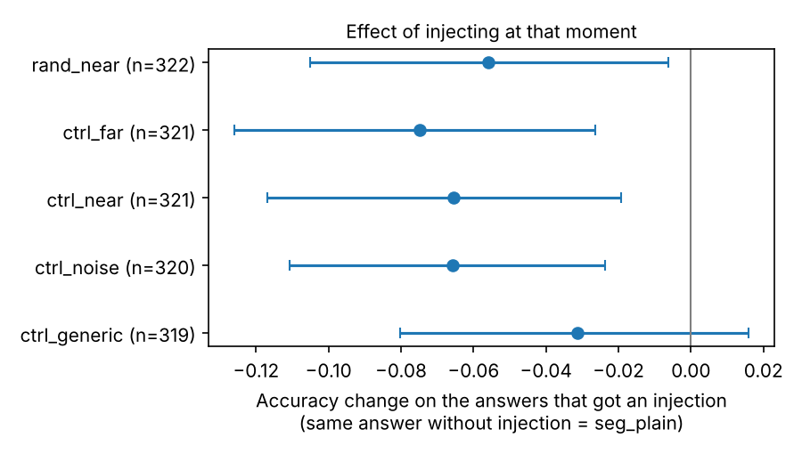
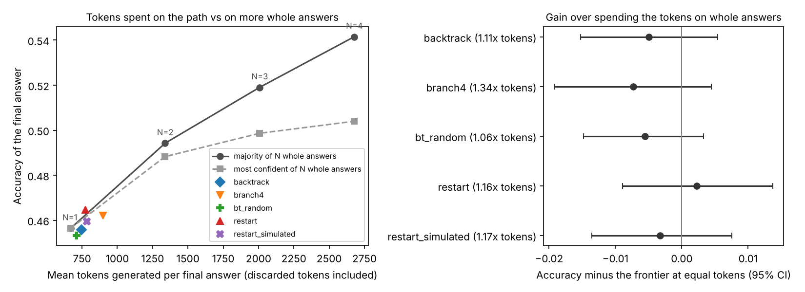

# Seeded reasoning: do ideas from distant fields help a small LLM solve math?

**Question.** People often solve a problem with an idea borrowed from a far-away field.
If a small LLM (Qwen2.5-1.5B-Instruct) gets a one-sentence strategy derived from an idea
in Daoism, cooking or martial arts, does it solve more math problems than with a math
heuristic, a physics principle, or random words? And does the *distance* of the source
field matter, once the extra step and extra tokens are controlled for?

> Status: Phases 1 to 3 are done, each with predictions written before the run (see git
> history). Phase 1: a strategy at the start does not help. Phase 2: the model's confidence does
> flag wrong answers, but inserting a strategy at that moment makes things worse. Phase 3: going
> back and resampling instead of adding text does no harm, but does not beat spending the same
> tokens on extra whole answers. Results and verdicts are below.

## Design

Each problem is solved k = 8 times under each of six conditions (temperature 0.7):

| Condition | What the model sees | Role |
|---|---|---|
| `plain` | the problem | baseline |
| `noise_translated` | random words, turned into a one-sentence strategy, then the problem | control: same extra step, no meaningful idea |
| `polya_translated` | a math heuristic (after Polya), turned into a strategy | same domain |
| `near_translated` | a physics, engineering or CS principle, turned into a strategy | near domain |
| `far_translated` | an idea from philosophy, arts, nature, crafts or strategy, turned into a strategy | far domain |
| `far_raw` | the far idea pasted next to the problem, no translation | tests distraction |

"Translated" means two calls to the same model: first a coach prompt turns the idea into a
general problem-solving move for this problem (without solving it), then the solver gets the
problem plus that move. Conditions 2 to 5 differ only in where the seed comes from, so
differences among them are about the source of the idea. All seeds are short paraphrases written
for this project (`src/sr/seeds.py`), not quotations.

**Data.** MATH-500, levels 3 to 5, 200 problems stratified by level, checked with
[math-verify](https://github.com/huggingface/Math-Verify) (compares answers as math, so 0.5 = 1/2).
Optional: Game of 24, generated and checked exactly here.

**Metrics.** Accuracy (pass@1); coverage pass@k for k = 1, 2, 4, 8 (unbiased estimator);
majority-vote accuracy; number of distinct answers; tokens per sample (both stages counted);
and *mixture coverage*: with a fixed budget of 8 samples, does half plain plus half seeded cover
more problems than 8 plain? All comparisons are paired by problem with 95% bootstrap intervals.

## Predictions (written before running)

1. `far_raw` will be **worse** than `plain` on pass@1: a pasted quote is irrelevant context, and
   models are easily distracted by it (Shi et al., 2023).
2. On pass@1, the translated conditions will be close to **each other**, including the noise
   control. Earlier work found that self-generated random examples matched or beat relevant ones
   on GSM8K and MATH, and that the accuracy of the examples mattered more than their relevance
   (Qin et al., 2025). So any gain may come from the extra step, not from the idea.
3. If distance matters at all, it will show in **coverage** (pass@8 and mixture coverage), not in
   pass@1: far seeds should produce more *different* attempts, so some new problems get solved.
   The test is `far_translated` against `noise_translated`, not against `plain`.

A null result on prediction 3 is a valid result and will be reported as such.

## Phase 1 results

Qwen2.5-1.5B-Instruct (vLLM, fp16, 2 x T4), MATH-500 levels 3 to 5: 198 problems (66 per level)
x 6 conditions x 8 samples = 9,504 generations, nothing missing. Truncation 2.5 to 3% and mean
cost 662 to 702 tokens per sample in every condition, so no condition got more room or compute.
Full log: `results/phase1/generations.jsonl.gz`; tables: `results/phase1/analysis/`.

| Condition | pass@1 | pass@8 | Majority vote | Distinct answers | Tokens |
|---|---|---|---|---|---|
| plain | 0.448 | 0.702 | 0.540 | 3.92 | 662 |
| noise_translated | 0.429 | 0.702 | 0.551 | 4.12 | 697 |
| polya_translated | 0.419 | 0.687 | 0.566 | 4.16 | 702 |
| near_translated | 0.433 | 0.737 | 0.571 | 4.19 | 697 |
| far_translated | 0.426 | 0.692 | 0.566 | 4.10 | 695 |
| far_raw | 0.448 | 0.707 | 0.576 | 3.94 | 667 |

Differences from `plain`, paired by problem, 95% bootstrap intervals (5,000 resamples):


**Verdicts on the predictions**

| Prediction | Result | Verdict |
|---|---|---|
| 1. `far_raw` worse than `plain` (distraction) | pass@1 difference 0.000 (-0.022 to +0.023) | wrong: the model ignored the pasted idea |
| 2. Translated conditions close to each other, noise included | all four within 1.5 points; far vs noise -0.003 (-0.028 to +0.023) | confirmed |
| 3. Far seeds raise coverage over the noise control | pass@8 far vs noise -0.010 (-0.061 to +0.040); equal-budget mixture plain + far 0.692 vs plain 0.702 | not supported |

**Other findings**

- Adding a strategy sentence costs about 2 points of pass@1: all four translated conditions are
  1.5 to 2.9 points below `plain`. Only Polya's interval excludes zero, and one such result in 15
  comparisons is expected by chance, but the four point the same way.
- Seeds add variety of the wrong kind: about 0.2 more distinct answers per problem, and the
  extra answers are wrong ones (distinct wrong answers 3.25 for plain, 3.4 to 3.5 with seeds).
- Problems solved only with a seed vs only without it are balanced: noise 15 vs 15, far 11 vs 13
  (`rescues_and_diversity.csv`). Near-domain seeds show 16 vs 9 and the highest pass@8 (+0.035,
  -0.015 to +0.086); not significant, kept as a hypothesis for a pre-registered follow-up.
- A trap to avoid: all seeded conditions together solve 166 problems vs 139 for plain, but that
  pools 40 samples per problem against 8. At equal budget there is no gain.

**What this rules out.** For this model and setup, any benefit of start-of-problem seeds is
smaller than about 2.5 points of pass@1 and 5 points of pass@8.

**Why it may have failed, and what Phase 2 tests.** (a) The 1.5B coach writes generic advice;
(b) the solver may barely use the hint; (c) a hint at the start cannot rescue a dead end that
appears halfway through. Phase 2 injects the strategy at the moment the model's own confidence
drops, and compares against injection at random moments.

## Changes after the pilot (30 problems, k = 4)

The pilot was used only to check the pipeline; its accuracy numbers are too noisy to read
(about +/-0.09 per condition). Two problems were fixed before the main run:

1. 16% of responses hit the 1,024-token limit before giving an answer. `max_tokens` is now 2,048.
2. Strategies often repeated the seed's imagery ("taste the problem as you go") instead of a math
   move. The coach prompt now asks for plain mathematical terms without the seed's words. The
   change applies to every translated condition, including the noise control.

The predictions above were not changed.

## Phase 2: inject the strategy when the model is unsure

**Question.** Phase 1 put the strategy at the start. Does a strategy help when it arrives at the
moment the model's own confidence drops, and does the source of the strategy matter then?

**How it works** (`src/sr/controller.py`). The model writes its answer in segments of 128 tokens.
After each segment, confidence = mean log-probability of the segment's tokens (near 0: sure of
every token; very negative: unsure). A rule with hysteresis, like a Schmitt trigger, fires after
2 consecutive segments below a threshold tau, at most 2 times per answer, with a 2-segment
cooldown. When it fires, the half-written line is cut and the model continues after
"Wait, this might not be the right path. Let me rethink the problem with a different strategy: ...".

| Condition | When | What is inserted |
|---|---|---|
| `seg_plain` | never | nothing (control; also logs when the rule *would* fire) |
| `ctrl_generic` | rule fires | "Let me rethink the problem." with no strategy |
| `ctrl_noise` | rule fires | strategy translated from random words |
| `ctrl_near` | rule fires | strategy translated from a physics, engineering or CS idea |
| `ctrl_far` | rule fires | strategy translated from a far-field idea |
| `rand_near` | random moments, same average rate | near-domain strategy (tests whether timing matters) |

**Paired by construction.** Segment s of sample j of problem p uses the same random seed in every
condition, so all conditions write the same text until the first injection. The four `ctrl_*`
conditions even fire at the same moment on the same answers. The effect of an injection is then
measured answer by answer against the same answer without it (`seg_plain`), a much sharper test
than Phase 1. The analysis checks how often the text really was identical before the injection.

**Calibration on held-out problems.** tau is the 20th percentile of segment confidences, measured
on the MATH-500 problems of levels 3 to 5 that are not in the test set (k = 4). The random-timing
rate is set on the same data so that random timing injects as often as the rule. Both are fixed
before the test run. Test set: the same 198 problems as Phase 1, k = 8.

### Phase 2 predictions (written before calibration and before the run)

4. **Confidence flags wrong answers.** On the test set, the lowest segment confidence of an answer
   predicts that the answer is wrong with AUROC above 0.65, and answers where the rule fires are
   much less accurate than answers where it stays silent.
5. **Interrupting alone does little.** On the answers where it fires, `ctrl_generic` changes
   accuracy by less than 5 points compared with the same answers without injection.
6. **Content still does not matter.** On the same injected answers, `ctrl_noise`, `ctrl_near` and
   `ctrl_far` are within 5 points of `ctrl_generic`. This is what Phase 1 suggests.
7. **Timing matters** (the controller's main claim; we give it even odds). Per injected answer,
   `ctrl_near` gains more than `rand_near`. Caveat stated in advance: answers flagged by the rule
   start with lower accuracy, so they have more room to improve and less to lose than randomly
   chosen ones. If `ctrl_generic` gains as much as `ctrl_near`, the gain is about when to
   interrupt, not about the strategy.

Outputs: `analysis/effects.csv` (effects with cluster bootstrap intervals over problems),
`pairing_check.csv`, `detection.json`, `injection_effects.png`.

## Phase 2 results

Same 198 test problems as Phase 1, 6 conditions x 8 samples = 9,504 answers, nothing missing.
Calibration on the 169 held-out problems (k = 4, 676 answers): tau = -0.172 (mean token
log-probability per segment); the rule fires on 20% of answers; the random-timing rate is 0.048
per segment, which matched it (20% of answers injected in every injection condition).
Pairing check: the text was identical to `seg_plain` up to the first injection for 90% (`ctrl_far`,
`rand_near`) to 97.5% (`ctrl_generic`) of injected answers; every effect below holds when
restricted to those. Full log and tables: `results/phase2/`.

| Condition | pass@1 (all answers) | Answers injected | Tokens | Truncated |
|---|---|---|---|---|
| seg_plain | 0.458 | 0% | 669 | 2.8% |
| ctrl_generic | 0.451 | 20.1% | 717 | 4.5% |
| ctrl_noise | 0.447 | 20.2% | 700 | 3.7% |
| ctrl_near | 0.447 | 20.3% | 698 | 3.6% |
| ctrl_far | 0.444 | 20.3% | 706 | 3.7% |
| rand_near | 0.446 | 20.3% | 690 | 2.6% |

Effect on the answers that got an injection, each compared with the same answer without it
(95% cluster bootstrap over problems):



| Condition | Accuracy without -> with injection | Difference (95% CI) | Rescues / breaks |
|---|---|---|---|
| ctrl_generic | 0.194 -> 0.163 | -0.031 (-0.080 to +0.016) | 22 / 32 |
| ctrl_noise | 0.194 -> 0.128 | -0.066 (-0.111 to -0.024) | 15 / 36 |
| ctrl_near | 0.190 -> 0.125 | -0.065 (-0.117 to -0.019) | 15 / 36 |
| ctrl_far | 0.193 -> 0.118 | -0.075 (-0.126 to -0.026) | 13 / 37 |
| rand_near | 0.301 -> 0.245 | -0.056 (-0.105 to -0.006) | 25 / 43 |

**Verdicts on the predictions**

| Prediction | Result | Verdict |
|---|---|---|
| 4. Confidence flags wrong answers | AUROC of the lowest segment confidence 0.740 on the test set (0.707 on calibration); accuracy 0.199 when the rule fires vs 0.524 when silent | confirmed |
| 5. Interrupting alone changes accuracy by less than 5 points | -0.031 (-0.080 to +0.016) | consistent, but the interval does not rule out a larger loss |
| 6. Strategy content does not matter (within 5 points of generic) | on the same answers, noise -0.040 (-0.091 to +0.010), near -0.037 (-0.085 to +0.004), far -0.049 (-0.098 to -0.004) vs generic | partly wrong: the source field does not matter, but adding a strategy is worse than a plain "rethink" |
| 7. Timing matters (`ctrl_near` gains more than `rand_near`) | difference per injection -0.010 (-0.070 to +0.057) | not supported: both hurt about equally |

**What goes wrong.** The model does follow the inserted strategy, and that is the problem.
Breaks outnumber rescues 2.4 to 2.8 times for every seeded condition. Answers get longer after an
injection (about 765 to 925-955 tokens for seeded strategies, 761 to 1,007 for generic), and more of
them end without an answer (about 4% to 10-15%). But running out of tokens is not the main cause:
among answers that were not truncated, the loss is the same (near -0.074, -0.127 to -0.025).
Reading the logs, a typical break is a strategy that carries the seed's framing into the math
("...particularly in the context of minimizing a quantity, as hinted by the physics idea"),
and the model then solves a different problem. The 1.5B coach does not fully obey the instruction
to drop the seed's words. Typical rescues are plain math moves ("factor the numerator and
denominator").

**What this means.** The detector half of the controller works: the model's own confidence finds
the answers that are going wrong (accuracy 0.20 vs 0.52). The remedy half does not: adding text to
a failing chain of thought makes a 1.5B model worse, whatever the text and wherever the idea
comes from. The next step keeps the detector and changes the remedy: when the rule fires, go back
to an earlier point and resample, instead of adding text (see Roadmap).

Follow-up checks were added after the run and are reported as such:
`results/phase2/analysis/checks_by_condition.csv`, `content_vs_generic.csv`, `timing.json`
(`python -c "from sr.phase2 import extra_checks; extra_checks('runs/phase2')"`).

## Phase 3: change the path, not the prompt

**Question.** Phase 2 showed that the detector works and that adding text is the wrong remedy.
If the controller instead goes back and samples again when confidence drops, does that beat
simply spending the same tokens on more whole answers?

### What the Phase 2 log already says (analysis of existing data, before any Phase 3 run)

These numbers come from the `seg_plain` answers of Phase 2 and shaped the design below
(`python -c "from sr.phase3 import phase2_baseline; phase2_baseline()"`).

- **The detector mostly recognizes hard problems.** Across all answers, the lowest segment
  confidence separates wrong from right answers with AUROC 0.740. Comparing only answers to the
  *same* problem, the AUROC drops to 0.615. A remedy that samples again can only use the second
  part: it cannot make the problem easier.
- **The rule fires early.** 65% of first fires (210 of 321) come after the second segment, so the
  2 low segments are the first 256 tokens of the answer. For those, going back 2 segments is the
  same as starting over.
- **Starting over does not pay.** Simulating "restart when the rule fires, at most twice" from the
  logged samples of the same problem gives accuracy 0.460 vs 0.458, for 16% more tokens.
- **The bar to beat.** Spending tokens on whole answers instead: majority vote of 2 answers gives
  0.490 for 2x the tokens, of 4 answers 0.539 for 4x; keeping the most confident of N answers
  stops improving near 0.49. Against this frontier, the simulated restart is -0.4 points
  (-1.3 to +0.6) at its token cost.

### Design

Same 198 test problems, k = 8, the same threshold tau and hysteresis as Phase 2 (fixed on held-out
problems, `results/phase2/calibration.json`). No text is ever added. When the rule fires
(`src/sr/phase3.py`):

| Condition | What happens | Role |
|---|---|---|
| `seg_plain` | nothing | control, and the source of the whole-answer frontier |
| `backtrack` | drop the 2 low segments, sample them again with a new random seed | local resample |
| `branch4` | drop them, sample 4 candidate continuations of 2 segments, keep the most confident | local search: the "choose a new path" half of the original idea |
| `restart` | drop the whole answer and start again | global resample, detector-driven |
| `bt_random` | backtrack at random moments, at the rate the rule fires | timing control |

At most 2 events per answer, as in Phase 2. **Every generated token is counted**, including
dropped segments and unchosen branches. Final answers are capped at 2,048 tokens and the total
per answer at 4,096.

**Paired and nested by construction.** All conditions use the same per-step random seeds, so they
write the same text until the first event, and the confidence-driven ones have their first event
at the same moment. Branch 0 of `branch4` uses the same seeds as `backtrack` after the event, so
`branch4` is `backtrack` plus 3 extra candidates and a choice. Differences between them measure
the choice alone.

**The decisive comparison: equal tokens.** For each condition, accuracy minus the whole-answer
frontier at the same mean tokens. The frontier is built from the `seg_plain` samples of the same
run: for N = 1 to 4 whole answers, the better of majority vote and "keep the most confident"
(exact over all subsets of the 8 samples), linear in between (mixing N and N + 1 answers is a
valid policy). Picking the better baseline after the fact favors the baseline, which is the safe
direction. Cluster bootstrap over problems. A remedy is worth keeping only if its gain over the
frontier has a 95% interval above 0.

### Phase 3 predictions (written before the run)

8. **Sanity: random backtracking does nothing.** `bt_random` is within 2 points of `seg_plain`
   overall. Going back at a random moment just draws another sample of the same path; the only
   expected bias is a slight one toward shorter answers.
9. **Restart matches the simulation.** Online `restart` has pass@1 within 1.5 points of the
   simulated 0.460, and its gain over the frontier is not above 0.
10. **Local resampling helps a little, not enough.** On answers with an event, `backtrack` gains
    between 0 and +5 points over the same answers without it, but its gain over the frontier is
    not above 0. When the rule fires late enough that `backtrack` keeps a prefix, it does not
    differ detectably from `restart` (few such answers; stated so the result is not over-read).
11. **Choosing among branches helps, but we give it less than even odds to pay for itself.**
    On the same first event, `branch4` beats `backtrack`, since the within-problem signal
    (AUROC 0.615) is weak but real. It costs about 1.4 to 1.6x the tokens of `seg_plain`, and we
    expect it to land on or below the frontier.

If all four hold, the conclusion is that for this model the confidence signal is mostly about
the problem, not the path, and the right use of it is to decide where to spend extra whole
answers, not to repair one answer.

Outputs: `analysis/summary.csv`, `effects.csv` (paired and nested effects), `budget.csv`,
`whole_answer_curves.csv`, `pairing_check.csv`, `detection.json`, `budget.png`. Unchosen
branches and dropped segments are logged for Roadmap item 5.

## Phase 3 results

Same 198 test problems, 5 conditions x 8 samples = 7,920 answers, nothing missing. Pairing check:
the text was identical to `seg_plain` up to the first event for 91% (`bt_random`) to 97% (`backtrack`)
of answers with an event. Reproducibility: with the same seeds, `seg_plain` wrote exactly the same
text as in Phase 2 for 81% of answers, with the same correctness for 97.5% (pass@1 0.456 vs 0.458);
the rest differ through GPU batch arithmetic. The detector replicates: AUROC 0.747 across all
answers, 0.637 within a problem; accuracy 0.174 where the rule fires vs 0.527 where it is silent.
Full log and tables: `results/phase3/`.

| Condition | pass@1 | Answers with an event | Tokens generated | Tokens in final answer | Truncated |
|---|---|---|---|---|---|
| seg_plain | 0.456 | 0% | 669 | 669 | 2.7% |
| backtrack | 0.456 | 20.0% | 745 | 672 | 2.8% |
| branch4 | 0.462 | 19.9% | 900 | 674 | 2.7% |
| restart | 0.465 | 19.9% | 775 | 671 | 2.9% |
| bt_random | 0.453 | 16.2% | 712 | 663 | 2.7% |



**The decisive comparison.** Accuracy minus the whole-answer frontier at the same tokens
(95% cluster bootstrap over problems):

| Condition | Tokens vs seg_plain | Gain over the frontier |
|---|---|---|
| backtrack | 1.11x | -0.005 (-0.015 to +0.005) |
| branch4 | 1.34x | -0.007 (-0.019 to +0.004) |
| restart | 1.16x | +0.002 (-0.009 to +0.014) |
| bt_random | 1.06x | -0.006 (-0.015 to +0.003) |
| restart, simulated from the seg_plain log | 1.17x | -0.003 (-0.014 to +0.008) |

No remedy beats the frontier. For reference, majority vote of 2 whole answers reaches 0.494 at 2x
the tokens and of 4 answers 0.541 at 4x.

Paired effects on the answers that had an event, against the same answers without it:

| Condition | Accuracy without -> with | Difference (95% CI) | Rescues / breaks |
|---|---|---|---|
| backtrack | 0.177 -> 0.164 | -0.013 (-0.064 to +0.035) | 27 / 31 |
| branch4 | 0.175 -> 0.187 | +0.013 (-0.037 to +0.067) | 30 / 26 |
| restart | 0.175 -> 0.203 | +0.029 (-0.025 to +0.083) | 39 / 30 |
| bt_random | 0.335 -> 0.300 | -0.035 (-0.082 to +0.012) | 15 / 24 |

Nested comparisons (same answers, same first event):

| Comparison | n | Difference (95% CI) | Rescues / breaks |
|---|---|---|---|
| branch4 vs backtrack (value of choosing among 4 paths) | 312 | +0.022 (-0.021 to +0.064) | 26 / 19 |
| restart vs backtrack, rule fired late (backtrack keeps a prefix) | 106 | +0.085 (0.000 to +0.171) | 17 / 8 |
| restart vs backtrack, rule fired early (both go back to the start) | 202 | +0.025 (+0.005 to +0.052) | 5 / 0 |

In `branch4`, the chosen path was not branch 0 in 72% of 354 branch events, and its mean
log-probability was higher by 0.049 per token, so the choice did act.

**Verdicts on the predictions**

| Prediction | Result | Verdict |
|---|---|---|
| 8. `bt_random` within 2 points of `seg_plain` | -0.003 (-0.012 to +0.006) | confirmed (it fired on 16% of answers, not 20%: the random rate was set for Phase 2's rule) |
| 9. Online `restart` within 1.5 points of the simulated 0.460, not above the frontier | 0.465; +0.002 (-0.009 to +0.014) | confirmed |
| 10. `backtrack` gains 0 to +5 points on answers with an event, not above the frontier; no detectable difference from `restart` on late fires | -0.013 (-0.064 to +0.035); -0.005 vs frontier; late fires: restart better by +0.085 (0.000 to +0.171) | frontier part confirmed; no gain at all; the late-fire difference is borderline and points against the prediction |
| 11. `branch4` beats `backtrack` on the same event; on or below the frontier | +0.022 (-0.021 to +0.064); -0.007 vs frontier at 1.34x tokens | direction right but not significant; frontier part confirmed |

**What the late fires suggest** (a pre-planned comparison, but small and borderline, so read it as
a hint). When the rule fires late, keeping the earlier text and resampling only the 2 low segments
lowers accuracy slightly (0.151 -> 0.113), while starting over raises it (0.151 -> 0.198). The same
pattern shows when the rule fires early: `restart` and `backtrack` differ only after a second event
(a second drop in confidence), and there `restart` wins 5 to 0. Both point the same way: the low
segments are a symptom, and the wrong turn usually happened before them.

**What this means.** Three phases, one consistent picture for this 1.5B model. Its confidence
mostly says how hard the problem is, and only weakly where a given answer went wrong. So nothing
done to one answer, whether adding a strategy (Phase 2) or changing its path (Phase 3), beats
spending the same tokens on another whole answer. Local search among paths (`branch4`) acts and
points the right way, but costs more than it returns. The useful role left for the detector is
deciding *which problems* get extra whole answers.

## Run it

Kaggle (T4 x2, Internet on): `notebooks/run_kaggle.ipynb`. Local:

```bash
pip install -e ".[dev,vllm]"          # or [hf] if vLLM does not run on your GPU
pytest -q                             # 21 tests, use mock models
python -m sr run --config configs/pilot.json      # 30 problems, k = 4
python -m sr run --config configs/main.json       # 200 problems, k = 8
python -m sr analyze --run runs/main
# Phase 2
python -m sr p2-calibrate --config configs/phase2_calib.json
python -m sr p2-run --config configs/phase2_s0.json     # and phase2_s1.json on the second GPU
python -m sr merge --runs runs/phase2_s0 runs/phase2_s1 --out runs/phase2
python -m sr p2-analyze --run runs/phase2
# Phase 3 (uses the Phase 2 threshold, no calibration step)
python -m sr p3-run --config configs/phase3_s0.json     # and phase3_s1.json on the second GPU
python -m sr merge --runs runs/phase3_s0 runs/phase3_s1 --out runs/phase3
python -m sr p3-analyze --run runs/phase3
```

Kaggle notebooks: `notebooks/run_kaggle.ipynb` (Phase 1), `notebooks/phase2_kaggle.ipynb` (Phase 2),
`notebooks/phase3_kaggle.ipynb` (Phase 3).

Compute: the main run is 9,600 solve generations (up to 1,024 tokens) plus 6,400 short
strategy generations (solve outputs up to 2,048 tokens). Speed is measured in the pilot; the run resumes where it stopped.
Every generation (seed, strategy, full response, tokens, correctness) is logged to
`runs/*/results.jsonl`.

## Roadmap

1. **Static seeds**: done, null result (above).
2. **Controller with text injection**: done (above). Confidence detects failing answers;
   injecting text at that moment hurts.
3. **Backtrack and resample**: done (above). No harm, no gain over whole answers at equal
   tokens. Low confidence is mostly a problem-level signal.
   Next, cheap and offline from the logged samples: use the detector to decide how many whole
   answers each problem gets (one if confident, more and a vote if not), judged on the same
   frontier.
4. **Stronger model**: repeat Phases 1 to 3 with a larger Qwen model, to see whether a model that
   can use advice benefits from it.
5. **Abandoned branches**: study the discarded branches from Phase 3 and what carries over into
   the final answer.

## Related work

- Yasunaga et al., *Large Language Models as Analogical Reasoners*, ICLR 2024: the model
  self-generates relevant examples before solving.
- Qin et al., *Relevant or Random: Can LLMs Truly Perform Analogical Reasoning?*, Findings of
  ACL 2025: random self-generated examples matched or beat relevant ones on math.
- Zhou et al., *Self-Discover: Large Language Models Self-Compose Reasoning Structures*,
  NeurIPS 2024: the model selects and composes general reasoning modules.
- Shi et al., *Large Language Models Can Be Easily Distracted by Irrelevant Context*, ICML 2023.
- Wang et al., *Thoughts Are All Over the Place: On the Underthinking of o1-Like LLMs*, 2025:
  frequent thought switching correlates with wrong answers.
- rSIM, *Incentivizing Reasoning Capabilities of LLMs via Reinforced Strategy Injection*
  (arXiv 2512.08300): a planner injects a strategy from a fixed set at each reasoning step.
  This project asks what happens when the strategy set is open and comes from other fields.

## Limitations

One small model, one benchmark (plus an optional second), seeds written by one person, and a
fixed translation prompt. Results say what happens for this model and setup, not for LLMs in
general.
